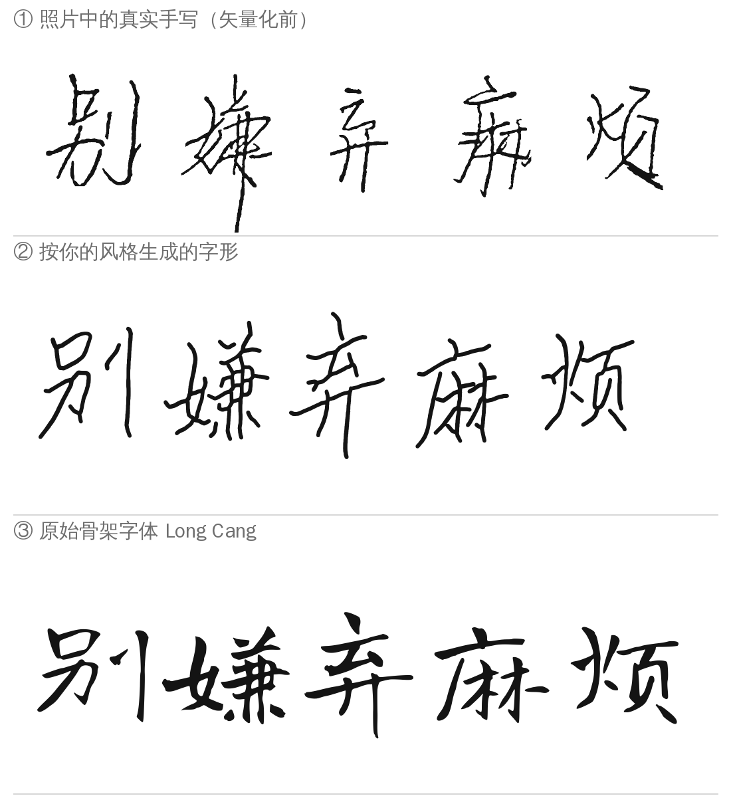
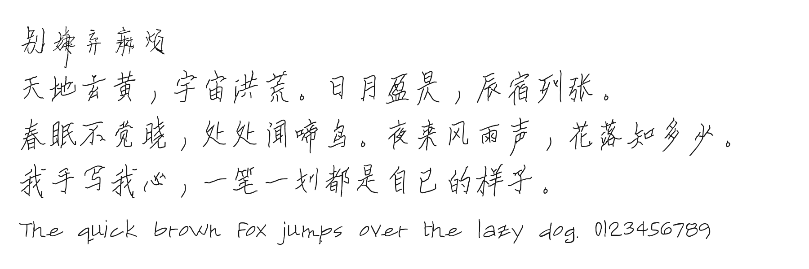

# 别嫌弃手写体 · BieXianQi Hand

这是一款手写字体，参考的是一张手写照片里的五个字“别嫌弃麻烦”。




## 成品

| 文件 | 说明 |
|---|---|
| `dist/BieXianQiHand-Regular.ttf` | 桌面字体，双击即可安装（Windows / macOS / Linux） |
| `dist/BieXianQiHand-Regular.woff2` | 网页字体 |

- 覆盖 GB2312 全部 **6763 个汉字**，另有拉丁字母、数字和中英文标点（共 7015 个字符）
- **别、嫌、弃、麻、烦** 这五个字直接用照片里的笔迹矢量化，是真迹
- 其余的字是程序按照片的笔迹特征生成的仿写字形：
  - 圆珠笔那样的细单线，笔画粗细约为字高的 3%，带一点轻微的压力变化
  - 字形偏瘦长（宽高比约 0.6–0.8），横画向右上扬约 9°，竖画略向右倾
  - 每个字的大小、角度、位置都有随机的小抖动，笔画还带轻微弯曲，收笔时会“带出去”一点
- 许可证：SIL Open Font License 1.1（见 `OFL.txt`），个人和商业使用都免费

> 说明：一张照片只有 5 个字，没办法真实还原其余几千个字各自的写法。生成字形借用了开源字体
> [Long Cang 龙藏体](https://github.com/googlefonts/longcang)（硬笔行书，OFL 许可）的字形结构作骨架，
> 再按上面这些特征改写笔画。想让更多的字变成你自己的笔迹，可以按下一节的方法补写。

## 把更多字换成自己的笔迹

```bash
pip install opencv-python-headless scikit-image fonttools freetype-py numpy pillow brotli
```

1. **打印模板**：`templates/common-1-468.pdf` 共 3 页，是最常用的 468 个字。要更多的字：

   ```bash
   python3 scripts/make_template.py --start 468 --count 468      # 接下来的 468 个常用字
   python3 scripts/make_template.py --chars "你的名字和常用词"         # 任意指定的字
   ```

   已经有真迹的字会自动跳过（`--include-existing` 可以保留它们）。
2. **书写**：用平时写字的笔，在方框里一格写一个字，按平时的速度和习惯写就好。
3. **拍照或扫描**：整页平放，四个角上的黑色标记都要拍进去。拍斜一点、光线不太均匀都没关系，程序会自动校正。
4. **导入并重新生成字体**：

   ```bash
   python3 scripts/ingest_sheets.py --template templates/common-1-468.json 照片/*.jpg
   python3 scripts/build_font.py
   ```

   导入的字形会存到 `glyphs/uXXXX.png`，生成字体时会替换掉对应的仿写字形。每张照片还会在
   `build/debug/ingest-*.png` 生成一张缩略图，方便检查。字写得不满意的话，删掉对应的 PNG 或者重写都可以。
   铅笔或浅色笔迹可以加 `--threshold 0.75`。

## 调整风格

`scripts/build_font.py` 顶部的 `STYLE` 里是全部的风格参数，也可以在命令行里临时覆盖，例如：

```bash
# 笔画粗一点、更潦草一点，先用几个字快速试效果
python3 scripts/build_font.py --chars "别嫌弃麻烦天地玄黄" --style '{"pen":36,"warp_amp":22,"rise_deg":12}'
python3 scripts/preview.py --font dist/BieXianQiHand-Regular-test.ttf --text "天地玄黄" --out build/try.png
```

常用的几个参数：`pen` 是笔画粗细，`rise_deg` 是横画上扬的角度，`lean_deg` 是竖画的倾斜，`sx`/`sy` 控制字形的胖瘦和高矮，
`warp_amp` 控制抖动和弯曲的程度，`overshoot` 是收笔带出去的长度，`adv` 是字距（1000 为标准全角宽度）。
完整构建大约需要 4 分钟（4 核）。

## 目录

```
sample/sample.jpg          原始照片
glyphs/                    真迹字形（照片里的五个字 + 以后从模板导入的字）
scripts/extract_sample.py  照片 → 校正、去背景、二值化、逐字切分 → glyphs/
scripts/build_font.py      生成字体（风格迁移 + 合并真迹 → dist/）
scripts/make_template.py   生成采集模板 PDF
scripts/ingest_sheets.py   读取写好的模板照片 → glyphs/
scripts/preview.py         渲染预览图
charsets/common3500.txt    按使用频率排序的 3500 个常用字
```

## 原理

- **真迹**：照片先展平光照（除以大半径模糊得到的背景），旋转 36° 摆正，再做阈值二值化，按多边形把五个字逐个切开，
  最后统一放到标准画布上（对应字体的 em 方框）。
- **矢量化**：位图先轻微模糊，再取 0.5 等值线得到亚像素精度的轮廓，用 Douglas–Peucker 算法简化，
  最后输出为闭合的二次 B 样条（TrueType 曲线）。
- **仿写**：先把骨架字体渲染成位图，经过整体仿射变换（压窄拉高、横画上扬、竖画右倾）、每个字的随机抖动和平滑的位移场扭曲，
  然后骨架化、剪掉毛刺、把笔画末端往外延长一点，再用一支粗细略有变化的圆头“笔”沿骨架重新画一遍，最后矢量化。
